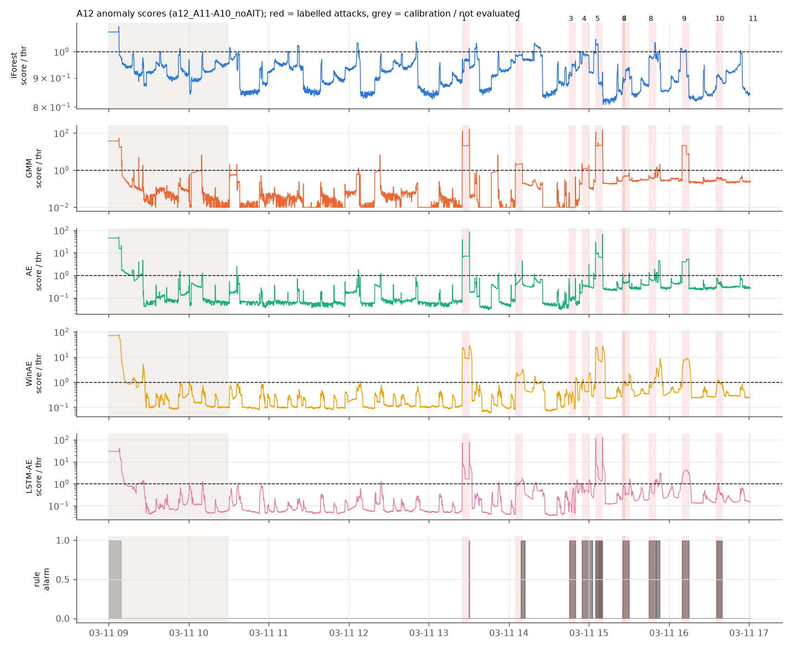
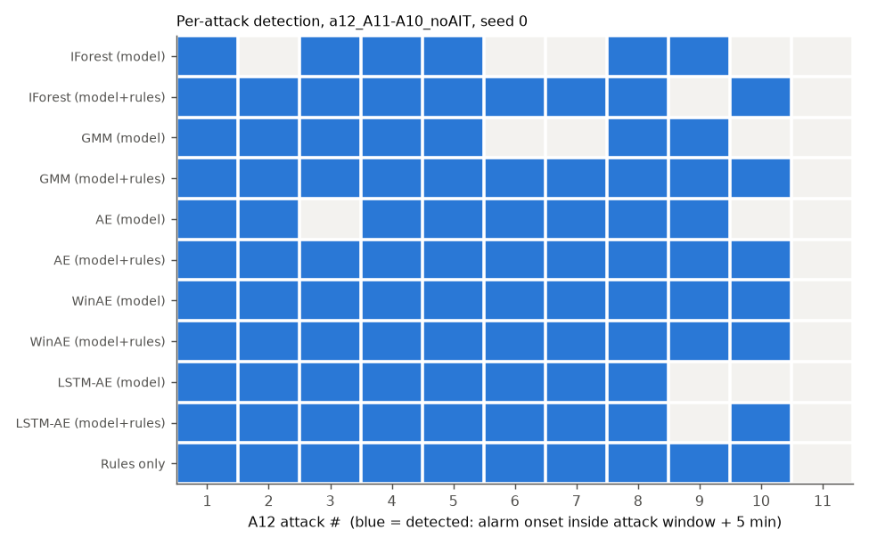
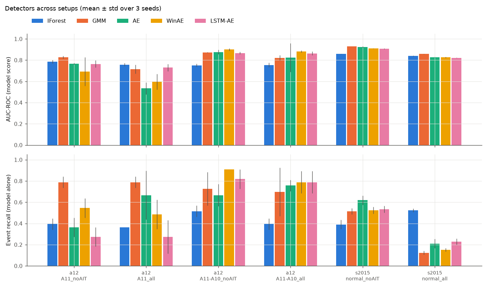
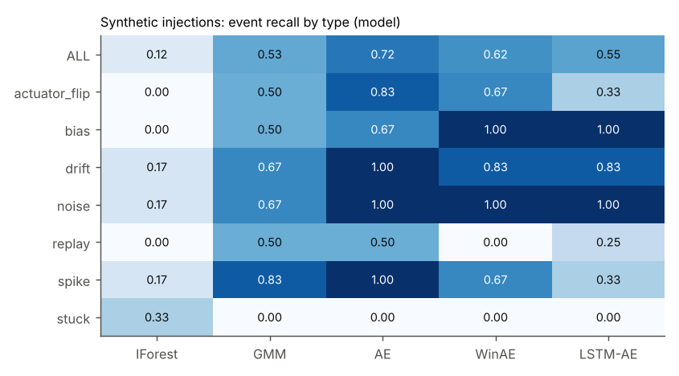

# Results

All numbers come from `outputs/` (full tables: `outputs/results_tables.md`, produced by
`scripts/summarize.py`). Neural models and IForest/GMM were trained with 3 seeds on A12
(mean ± std shown where relevant), on SWaT 2015 as well.

> **Status.** The tables below were regenerated after the code-review fixes (early stopping on
> contiguous time blocks, a training-time threshold computed on contiguous smoothed blocks,
> consistent contribution normalisation, injection sigma from valid rows, ...). What changed and
> by how much is listed in [docs/review_fixes.md](docs/review_fixes.md). Two further evaluations
> of the explanation layer are in [docs/synthetic_explanation_eval.md](docs/synthetic_explanation_eval.md)
> and [docs/swat2015_explanation_eval.md](docs/swat2015_explanation_eval.md). The A12 configuration
> and the hyper-parameters were chosen by looking at A12 (11 attacks), so the A12 numbers are
> optimistic; SWaT 2015 and the synthetic injections are the less biased checks.

## 1. Main setup: train A11 (+A10), test A12

Evaluation window 10:30-17:00 (11 attacks, 3,139 attack seconds). Thresholds are the 99.5%
quantile of each model's score on the normal calibration hour 09:30-10:30. "FPR clean" is the
false-positive rate on normal data before the first attack (10:30-13:24). Event recall requires
an alarm to *start* inside [attack start, attack end + 5 min].

### Best configuration: A11 + A10 training, AIT analysers excluded (32 features)

| Detector | AUC-ROC | AUC-PR | F1 | FPR clean | Event recall | False-alarm events | Median delay |
|---|---|---|---|---|---|---|---|
| Isolation Forest | 0.751 ± 0.014 | 0.32 | 0.14 | 2.4% | 0.52 | 7.3 | 287 s |
| GMM (BIC, 16 comp.) | 0.871 ± 0.003 | 0.72 | **0.58** | 0.3% | 0.73 | 7.0 | 10 s |
| Autoencoder (point) | 0.877 ± 0.021 | 0.67 | 0.54 | 0.3% | 0.67 | 6.7 | 70 s |
| **Window AE (2 min)** | **0.900 ± 0.010** | 0.59 | 0.57 | **0.2%** | **0.91** | **2.3** | 41 s |
| LSTM-AE (2 min) | 0.867 ± 0.011 | 0.54 | 0.50 | 0.5% | 0.82 | 4.7 | 188 s |
| Rules only | 0.797 | 0.56 | 0.71 | 0.0% | 0.91 | 0 | 24 s |
| GMM + rules | 0.957 ± 0.002 | 0.83 | 0.82 | 0.3% | 0.91 | 7.0 | 11 s |
| AE + rules | 0.949 ± 0.007 | 0.81 | 0.81 | 0.3% | 0.85 | 6.7 | 14 s |
| Window AE + rules | 0.947 ± 0.002 | 0.70 | 0.79 | 0.2% | 0.91 | 2.3 | 15 s |

### Findings

1. **Temporal context helps most for event detection.** The window autoencoder finds 10/11
   attacks with only 2.3 false-alarm events over 6.5 h and 0.2% FPR. Point models (GMM, AE) miss
   the in-range LIT101 spoof (#6), the standby pump P102 (#7) and the LIT601 oscillation (#10).
2. **Models and rules are complementary.** The transparent rule layer (unseen actuator states,
   out-of-range sensors) alone finds 10/11 attacks with zero false alarms, because most A12
   attacks either switch equipment that never moves in normal operation (#3, #7, #8) or force
   values out of range (#4, #9, #10). It cannot see actuator *combinations* (#1, #5: each valve
   state is legal on its own) or in-range manipulation; there the models are needed. Combined,
   AUC rises to 0.95-0.96 and the median detection delay drops to 11-15 s.
3. **Attack #11 (AIT402 spoof, 70 s at the end of the file) is missed by every configuration
   without AIT**, and AIT is excluded because it drifts. This is the explicit price of the
   noAIT choice.
4. **Domain shift dominates.** With AIT features the A11-only models are unusable after
   re-calibration (GMM 24%, AE 42%, window AE 57%, LSTM-AE 76% FPR clean): water quality drifts
   between February and March. Adding A10 (Dec 2023, different regime) to training widens the
   learnt normal region and helps every neural model (window AE AUC 0.69 -> 0.90 without AIT).
5. **Thresholds must be re-calibrated at deployment, and how badly depends on the training data.**
   With the threshold taken from the training data (no calibration hour), the FPR on clean A12
   normal data is 4-8% for the neural models and GMM in the main configuration (A11+A10, noAIT;
   16-20 false-alarm events instead of 2-7 with the calibration hour, IForest 17%), but 50-100% when the
   training data is only A11 or when AIT features are used (IForest excepted): the models then alarm on
   practically all clean data. Earlier versions of this table showed 97% for the GMM and <= 0.1% for the window
   models only because of a biased computation of the training threshold (see
   [docs/review_fixes.md](docs/review_fixes.md)); the window models are not more robust than the others.
6. **Isolation Forest is the weakest baseline** (AUC 0.75, long delays), consistent with the EDA.
7. **Evaluation caveat.** After attack #1 the dechlorination pumps P401/P403/UV401 stay off for
   the rest of the day, so "normal" seconds between later attacks are not truly normal. That is
   why FPR is reported on the clean pre-attack period and why event recall requires an alarm
   onset: with the common "any alarm overlaps the attack" rule LSTM-AE (A11 only) would get 0.94
   instead of 0.36 just by staying in alarm all afternoon.

### Other configurations (model alone, mean of 3 seeds)

| Training / features | IForest | GMM | AE | WinAE | LSTM-AE |
|---|---|---|---|---|---|
| A11 / noAIT: AUC, event recall | 0.78, 0.39 | 0.83, 0.79 | 0.77, 0.36 | 0.69, 0.55 | 0.76, 0.27 |
| A11 / all: AUC, FPR clean | 0.76, 1.6% | 0.71, 24% | 0.53, 42% | 0.60, 57% | 0.73, 76% |
| A11+A10 / all: AUC, event recall | 0.75, 0.39 | 0.82, 0.70 | 0.82 ± 0.14, 0.76 | 0.88, 0.79 | 0.86, 0.79 |

With only 15 h of A11 the GMM is the most robust model (consistent with the EDA learning curve);
the autoencoders need the extra 100 h of A10. The point AE with AIT is unstable across seeds (AUC 0.82 ± 0.14).

## 2. Second benchmark: SWaT 2015 (train 2015 normal, test 2015 attacks)

Training: 2015 normal_v1 without the first 6 h (start-up) and the last 12 h (threshold
calibration). Test: the 4-day attack file (35 labelled segments for the 36 attacks). No AIT, 27
features, training rows subsampled (AE every 10 s, windows every 30 s), 3 seeds.

| Detector | AUC-ROC | AUC-PR | F1 (point) | Event recall | Overlap recall | False-alarm events (4 days) |
|---|---|---|---|---|---|---|
| Isolation Forest | 0.859 ± 0.001 | 0.70 | **0.72** | 0.39 | 0.42 | 107 |
| GMM | **0.930 ± 0.001** | **0.83** | 0.52 | 0.51 | 0.89 | 384 |
| Autoencoder | 0.924 ± 0.004 | **0.83** | 0.68 | **0.62** | 0.87 | 404 |
| Window AE | 0.909 ± 0.002 | 0.81 | 0.70 | 0.52 | 0.82 | 179 |
| LSTM-AE | 0.907 ± 0.002 | 0.81 | 0.63 | 0.53 | 0.79 | 258 |
| Rules only | 0.531 | 0.13 | 0.18 | 0.46 | 0.71 | 104 |

With all features (incl. AIT) every model is worse (AUC 0.82-0.86, IForest 0.84; event recall 0.12-0.23
except IForest 0.52): the AIT drift effect seen in 2026 also exists inside the 2015 recording.

- The ranking of the density / reconstruction models is the same as on A12 (GMM ≈ AE > window
  models > IForest in AUC), and the AUCs match the EDA quick check (0.92 / 0.91), which supports
  that the A12 conclusions are not an artefact of one small test day.
- Unlike A12, the 2015 attack days produce many alarm events outside labelled attacks (hundreds
  over 4 days, event precision 0.08-0.16). Part of this is the known shift between the 2015
  normal and attack weeks, part are long after-effects of attacks that are labelled normal. The
  rule layer helps much less here (many 2015 attacks change sensor values inside their range).
- The official attack list is now in the knowledge base and the explanations of the 36 attacks are evaluated in
  [docs/swat2015_explanation_eval.md](docs/swat2015_explanation_eval.md) (the attacked tag is in the top 3 / rules for 61% of the
  18 attacks that IForest detects; detection is the bottleneck).

## 3. Synthetic anomaly injection

40 injections (3 random realisations, 7 types, 120-300 s each, magnitudes 2-10 σ, σ of the valid
training rows) on the clean part of A12 (10:35-13:15), using the main configuration (A11+A10, noAIT, seed 0). Detection =
alarm onset in [start, end + 2 min]. *hit@k* = the injected tag is among the top-k contributing
features (root-cause localisation, checks the input given to the explainer).

| Type | IForest | GMM | AE | WinAE | LSTM-AE |
|---|---|---|---|---|---|
| spike (5 s) | 0.17 | 0.83 | 0.67 | 0.17 | 0.00 |
| bias | 0.00 | 0.50 | 0.83 | 1.00 | 0.67 |
| drift | 0.17 | 0.67 | 1.00 | 0.83 | 0.83 |
| noise | 0.17 | 0.67 | 0.67 | 1.00 | 0.67 |
| stuck | 0.33 | 0.00 | 0.00 | 0.00 | 0.00 |
| actuator flip | 0.00 | 0.50 | 0.83 | 0.67 | 0.33 |
| replay (30 min old) | 0.00 | 0.50 | 0.50 | 0.00 | 0.25 |
| **all: recall** | 0.13 | 0.53 | **0.65** | 0.55 | 0.40 |
| all: hit@1 / hit@3 | 0.25 / 0.33 | 0.45 / 0.75 | 0.50 / 0.78 | 0.60 / **0.83** | **0.73 / 0.83** |
| false-alarm events (3 x 2.7 h) | 10 | 9 | 17 | **0** | 4 |

- A **stuck/frozen** sensor is invisible to every model when the frozen value is plausible:
  each sample is normal and the window is short. A dedicated "zero variance for N minutes"
  rule would be the natural fix (implemented as an opt-in rule, see section 5).
- **Replay** is hard for all models (<= 0.5), as expected: values and dynamics are normal.
- The window AE has no false alarm on the clean part and the best recall on noise and bias; the point AE has
  the highest overall recall but 17 false-alarm events; the LSTM-AE localises the injected tag best (hit@1 0.73).
  Short **spikes** are mostly missed by the 2-minute window models.
- These numbers are lower than in the first version of this report (AE 0.73, window AE 0.63), because
  the injection sigma was inflated by start-up and gap rows; see [docs/review_fixes.md](docs/review_fixes.md).

## 4. Per-anomaly JSON and explanation layer

`scripts/export_and_explain.py` turns every alarm event into a JSON record
(`outputs/anomalies/*.json`, schema `docs/anomaly_event.schema.json`) and explains it
(`outputs/explanations/*.md`, template back-end; the output of the Claude back-end is in
`outputs/explanations/llm/`). Example (window AE + rules, A12 attack #4, template back-end):

> Between 14:54:50 and 15:02:41 (472 s) the WinAE detector and the rule layer flagged an anomaly
> in P1 (raw water supply), P3 (ultrafiltration (UF)), P4 (dechlorination (UV + NaHSO3)); peak
> score 2.3x the threshold. Most likely interpretation: sensor value forced outside its normal
> range (spoofing or stuck sensor). Evidence: LIT101 400 to 980.8 mm vs normal 494 to 833.6;
> rule: LIT101 left its normal range. Similar known attacks: A12 attack 4 (LIT101 spoofing, tank
> overflow); A12 attack 2 (stage 1 flow disruption). Matching pattern: sensor spoofing with an
> out-of-range constant value.

Explanation quality on the 10 detected A12 attacks (window AE + rules):

| Check | Score |
|---|---|
| attacked tag among the top-3 model contributors | 0.70 |
| attacked tag among top-3 contributors or new rule violations | 0.90 |
| signature category correct (7 classes) | 0.70 |
| correct A12 attack retrieved among top-2 known attacks | 0.90 |
| leave-one-out: top retrieved attack has the same category | 0.30 |

The known-attack score is optimistic because the A12 catalog is in the knowledge base; the
leave-one-out row (own entry removed) is the honest number. (Retrieval now boosts the attacked tags;
this raised the known-attack score from 0.8 to 0.9 and lowered the leave-one-out score, see
[docs/llm_vs_template_report.md](docs/llm_vs_template_report.md) section 8. The leave-one-out score moves by one
attack when the networks are retrained: 0.3-0.5.) The signature classifier was
designed knowing the A12 attack types, so the synthetic localisation numbers above are the less
biased test of the evidence the explainer receives: there the injected tag is in the top 3 / rule hits in
97-100% of the detected cases ([docs/synthetic_explanation_eval.md](docs/synthetic_explanation_eval.md)). On SWaT 2015 it is
61% for the 18 attacks that IForest detects ([docs/swat2015_explanation_eval.md](docs/swat2015_explanation_eval.md)). The confidence of an
explanation is capped by an evidence score (`calibrate_confidence`); it is reliable for the window AE on the synthetic data
but not on SWaT 2015.

## 5. What to do next

1. ~~Run the LLM back-end and compare it with the template.~~ Done: see
   [docs/llm_vs_template_report.md](docs/llm_vs_template_report.md) (LLM better on 9 of 10
   events, no invented numbers; the attack clock times in the catalog were removed in a control
   run and the same attacks were still recognised). The outputs are in `outputs/explanations/llm/`.
2. ~~Get the 2015 attack list.~~ Done: 36 attacks are in the knowledge base and evaluated
   ([docs/swat2015_explanation_eval.md](docs/swat2015_explanation_eval.md)). Still open: the tag documentation and set points from iTrust.
3. Frozen-sensor rule: implemented as an opt-in rule (`RuleMonitor(stuck_s=...)`, unit-tested on
   synthetic data) but not yet run on the real data:
   `python scripts/run_synthetic.py --stuck-rule 120`. AIT detrending (to bring back attack #11)
   is still open.
4. Sweep the window length (1-5 min) and the calibration window length for the threshold.
5. ~~Retrieve known-attack chunks by the affected tags.~~ Done (stronger tag boost, tag ranges expanded);
   retrieving the two best generic patterns instead of one is still open (the pattern fits the injected type in only
   31-33% of the synthetic cases).
6. SWaT 2015 detection is the bottleneck for the explanations there (half of the attacks are not detected,
   hundreds of false-alarm events): drift handling and alarm merging for the 4-day recording.
